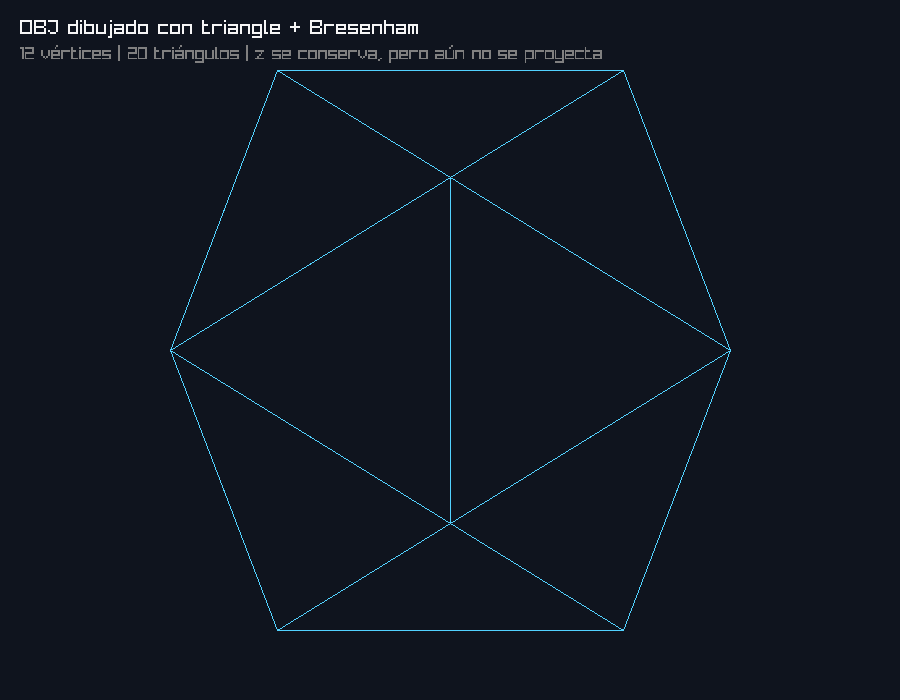

# Proyecto 1 — Parte 1: modelo OBJ con Rust y Raylib

Este proyecto carga un archivo OBJ con código propio, recorre los índices de sus
caras y dibuja cada triángulo como un wireframe. No utiliza las funciones de
Raylib para cargar ni renderizar modelos 3D.

## Resultado



## Cómo funciona

1. `ObjModel::load` lee los vértices (`v`) y las caras (`f`) del archivo.
2. Las caras con más de tres vértices se convierten en triángulos.
3. Los índices de cada triángulo permiten buscar sus tres vértices.
4. `project_vertices` usa `x` y `y`, ajusta la escala y centra el modelo.
5. `triangle` dibuja sus tres lados con el algoritmo de líneas de Bresenham.
6. `line` coloca los píxeles individualmente mediante Raylib.

El componente `z` se carga y se conserva, pero todavía no participa en la
proyección, tal como corresponde a esta parte del proyecto.

## Ejecutar

Se requiere una instalación de Rust. Desde la raíz del repositorio:

```bash
cargo run --release
```

Para abrir otro OBJ, se puede pasar su ruta:

```bash
cargo run --release -- ruta/al/modelo.obj
```

Para regenerar la captura incluida en este README:

```bash
cargo run --release -- --screenshot
```

## Verificación

```bash
cargo test
cargo clippy -- -D warnings
cargo fmt --check
```

